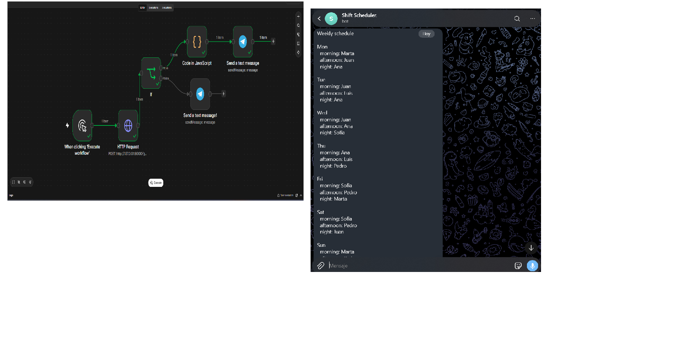

# Shift Scheduler

Weekly shift scheduling for small businesses. A constraint-programming solver (Google OR-Tools CP-SAT) builds the schedule, a FastAPI service exposes it, and an n8n workflow validates the result and delivers it through Telegram.

## How it works

```
Manual trigger -> HTTP Request -> If (ok?) -> Code (format) -> Telegram (schedule)
                                      |
                                      +--> Telegram (error alert)
```



- **Solver** (`solver/model.py`): builds and solves the CP-SAT model.
- **API** (`solver/main.py`): `POST /generate` receives employees, shifts, staffing and unavailability, and returns the schedule.
- **Workflow** (`n8n-workflows/generate-weekly-schedule.json`): calls the API, checks `ok`, formats the schedule as text and sends it by Telegram. If no schedule exists, it sends an alert instead.

## Model

Hard constraints:

- Each shift gets exactly the required number of employees.
- At most one shift per employee per day.
- Employees are never assigned on their unavailable days.
- A weekly cap on shifts per employee (default 5).
- No night shift followed by a morning shift the next day.

Objective: minimize the gap between the most and the least loaded employee.

## Performance

Solve time on synthetic data (7 days, 3 shifts, one random unavailable day per employee, seed 42, 3 runs per case, 10 s time limit, on a single laptop). The first version required *at least* N people per shift and added a second term to the objective to penalize overstaffing. Requiring *exactly* N people per shift fixes the total number of assignments, so that term became unnecessary and the search space shrank.

| Scenario | Employees | Before (s) | After (s) | Speedup |
|---|---|---|---|---|
| relaxed | 10 | 0.046 | 0.049 | 1.0x |
| relaxed | 30 | 0.125 | 0.079 | 1.6x |
| relaxed | 100 | 0.800 | 0.357 | 2.2x |
| relaxed | 300 | 6.123 | 0.987 | 6.2x |
| relaxed | 500 | 9.698 | 1.730 | 5.6x |
| tight | 10 | 0.508 | 0.043 | 11.8x |
| tight | 30 | 1.251 | 0.088 | 14.2x |
| tight | 100 | 1.664 | 0.300 | 5.5x |
| tight | 300 | 3.935 | 0.958 | 4.1x |
| tight | 500 | 11.032 | 1.715 | 6.4x |

Raw results: `docs/benchmark_baseline.md` and `docs/benchmark_optimized.md`. Reproduce with `python benchmark.py <label>`.

Limitations: synthetic data, a single machine, and times vary between runs.

## Run it

Requirements: Python 3.12+, Node.js 20+.

```bash
# 1. Solver API
cd solver
python -m venv venv
source venv/Scripts/activate    # Windows Git Bash; on Linux/macOS: source venv/bin/activate
pip install ortools fastapi uvicorn
uvicorn main:app --reload       # http://127.0.0.1:8000/docs

# 2. n8n (in another terminal)
npm install -g n8n
n8n                             # http://localhost:5678
```

To import the workflow, copy the content of `n8n-workflows/generate-weekly-schedule.json` and paste it onto an empty n8n canvas (Ctrl+V). Then create a Telegram credential with your own bot token and replace `YOUR_CHAT_ID` in both Telegram nodes.

## Project structure

```
solver/             model, API, tests and benchmark scripts
n8n-workflows/      exported n8n workflow
docs/               benchmark results and screenshots
```

## Next steps

- Docker Compose to start the API and n8n together.
- Store employees and schedules in PostgreSQL.
- Next.js dashboard to manage employees and view schedules.